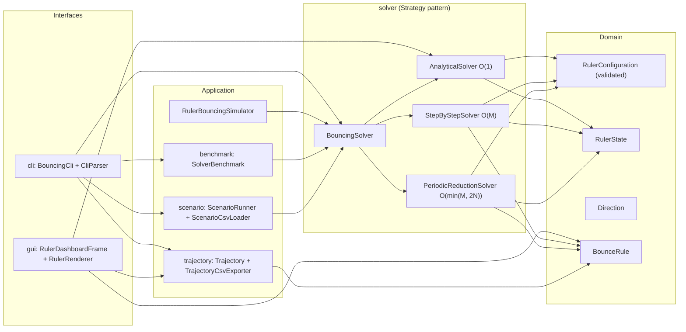

# Bounded Ruler Discrete Bouncing Simulator
### Discrete Periodic Motion with Elastic Reflection over $[0, N]$
**O(M) Step-by-Step Simulation versus O(1) Closed-Form Triangular Wave Solution in Java 8 - 21**

[](https://github.com/KevinAndrey96/bounded-ruler-discrete-bouncing-simulator-java/actions/workflows/ci.yml)
[](https://openjdk.org/)
[](https://maven.apache.org/)
[](https://junit.org/junit5/)
[](https://www.docker.com/)
[](scripts/verify_bouncing.py)
[](pom.xml)

A walker moves one mark per step over a giant ruler with marks $0, 1, \dots, N$ and reverses its direction every time it reaches an edge. This repository turns a 2017 academic exercise (originally `juego-ninos`, a NetBeans project driven by `JOptionPane` dialogs) into a small but rigorous simulation engine. It has three interchangeable solvers, a proof of their equivalence, a headless CLI for automation, an animated Swing dashboard, a trajectory exporter, seeded reference scenarios, Docker packaging and a JDK 8/11/17/21 CI matrix.

---

## 🧩 Original Problem Statement

> *En el parque de un barrio de Bogotá hay un nuevo juego para que los niños aprendan a contar. Consiste en una regla gigante con marcas entre 0 y N. Los niños se mueven paso a paso sobre las marcas de la regla y mantienen la misma dirección a menos que lleguen a uno de los extremos, en cuyo caso cambian de dirección.*
>
> *Datos: N es la marca más alta, P la posición inicial, d la dirección inicial (d = 1 derecha, d = -1 izquierda) y M el número de pasos. Reportar la posición después de M pasos.*
>
> *Ejemplo: N=5, P=4, d=1, M=4. Al finalizar, el niño estará en la posición 2.*

---

## 📐 Mathematical Formulation

### 1. Discrete dynamical system

The state after $k$ steps is the pair $S_k = (p_k, d_k)$ with $p_k \in \{0, \dots, N\}$ and $d_k \in \{-1, +1\}$. The walker first reflects if it faces a wall and then moves one mark:

$$d_{k+1} = \begin{cases} -d_k & \text{if } (p_k = N \land d_k = +1) \lor (p_k = 0 \land d_k = -1) \\ d_k & \text{otherwise} \end{cases} \qquad p_{k+1} = p_k + d_{k+1}$$

This is exactly the semantics of the original simulation: a walker that arrives at $N$ keeps $d = +1$ until its next step, where it bounces.

### 2. Unfolding the reflections: the triangular wave

Reflecting the ruler about its walls turns the bouncing walk into a uniform walk on the cyclic group $\mathbb{Z}_{2N}$. A virtual phase $u$ advances one unit per step, and the real position is recovered with the periodic triangular wave of period $2N$:

$$T_N(u) = N - \lvert N - u \rvert = \begin{cases} u & \text{if } 0 \le u \le N \\ 2N - u & \text{if } N < u < 2N \end{cases}$$

The initial phase unfolds the starting direction:

$$u_0 = \begin{cases} P & \text{if } d = +1 \\ (2N - P) \bmod 2N & \text{if } d = -1 \end{cases}$$

### 3. Closed-form O(1) solution

For $M = 0$ the answer is the initial state $(P, d)$. For $M \ge 1$:

$$u_M = \left(u_0 + (M \bmod 2N)\right) \bmod 2N, \qquad P_M = T_N(u_M), \qquad d_M = \begin{cases} +1 & \text{if } 1 \le u_M \le N \\ -1 & \text{if } u_M = 0 \lor u_M > N \end{cases}$$

The direction rule handles the inflection points exactly: $u_M = N$ means the walker has just reached the right wall moving forward, and $u_M = 0$ means it has just reached the left wall moving backward. A naive rule such as $u_M < N$ misreports the direction on arrival at $N$, and the exhaustive equivalence test catches it.

**Worked example** ($N = 5, P = 4, d = +1, M = 4$): $u_0 = 4$, $u_4 = (4 + 4) \bmod 10 = 8$, $P_4 = 5 - \lvert 5 - 8 \rvert = 2$ and, since $8 > N$, $d_4 = -1$. This matches the statement.

### 4. Periodicity lemma (basis of the hybrid solver)

After the first step every state is *canonical* (its direction equals the direction of the last displacement), and the canonical states form a single orbit of exact length $2N$. Therefore:

$$S_M = S_{((M - 1) \bmod 2N) + 1} \qquad \forall\, M \ge 1$$

so at most $2N$ steps ever need to be replayed. Note that $S_{2N}$ is not always $S_0$: starting at $(N, -1)$ the walker comes back to $N$ with direction $+1$.

### 5. Overflow safety

All arithmetic uses signed 64-bit integers. Taking $M \bmod 2N$ before the addition bounds the intermediate value by $u_0 + (M \bmod 2N) < 4N$, so the engine accepts any $M \le 2^{63} - 1$ and any $N \le \lfloor (2^{63} - 1) / 4 \rfloor = 2{,}305{,}843{,}009{,}213{,}693{,}951$ without overflow.

---

## ⚖️ Solver Comparison

| Solver | CLI name | Time | Memory | Replayed steps | Use case |
| :--- | :---: | :---: | :---: | :---: | :--- |
| `StepByStepSolver` | `step` | $O(M)$ | $O(1)$ | $M$ | Reference oracle, faithful to the 2017 algorithm |
| `PeriodicReductionSolver` | `periodic` | $O(\min(M, 2N))$ | $O(1)$ | $((M - 1) \bmod 2N) + 1$ | Small rulers with astronomically large $M$ |
| `AnalyticalSolver` | `analytical` | $O(1)$ | $O(1)$ | $0$ | Any input, including $N = 10^{12}$ and $M = 2^{63} - 1$ |

Indicative benchmark (`--benchmark`, best of 5 runs, Apple Silicon, JDK 22) for $N = 1000, P = 999, d = -1, M = 10^9$:

| Solver | Final state | Best time | Speedup |
| :--- | :---: | ---: | ---: |
| step | $(999, -1)$ | 870,820,125 ns | 1.0x |
| periodic | $(999, -1)$ | 2,042 ns | 426,454x |
| analytical | $(999, -1)$ | 458 ns | 1,901,354x |

---

## 🏗️ Architecture



The domain layer has no dependency on I/O or Swing. Solvers depend only on the domain through the `BouncingSolver` port, and the CLI receives its collaborators (`SolverCatalog`, `CliParser`, `TrajectoryCsvExporter`, `ScenarioCsvLoader`) through its constructor, so every layer is tested in isolation. The project has zero runtime dependencies.

```text
src/main/java/com/kevinandrey/simulation/bouncing/
├── RulerBouncingSimulator.java        facade: simulateStepByStep, solvePeriodic, solveAnalytical
├── domain/                            Direction, RulerConfiguration, RulerState, BounceRule
├── solver/                            BouncingSolver port, 3 strategies, SolverCatalog
├── trajectory/                        lazy O(1)-memory Trajectory, CSV exporter
├── benchmark/                         best-of-k wall clock benchmark with replay budget
├── scenario/                          seeded reference scenarios loader and runner
├── cli/                               headless CLI with stable exit codes
└── gui/                               Swing dashboard and headless-testable renderer
scenarios/reference-scenarios.csv      14 seeds generated by an independent Python model
scripts/verify_bouncing.py             7-suite verification script
```

---

## 🚀 Usage

### Build

```bash
mvn -B clean verify                       # compiles for Java 8 bytecode, runs 119 JUnit 5 tests
java -jar target/bounded-ruler-simulator.jar
```

### Headless CLI

```bash
# Original statement example (also the default with no arguments)
java -jar target/bounded-ruler-simulator.jar --length 5 --start 4 --direction 1 --steps 4

# Closed form on a trillion-mark ruler
java -jar target/bounded-ruler-simulator.jar -n 1000000000000 -p 1 -d -1 -m 999999999999999

# Compare the three solvers and assert they agree
java -jar target/bounded-ruler-simulator.jar -n 1000 -p 999 -d -1 -m 1000000000 --benchmark

# Print every state and export the trajectory as CSV (step,position,direction)
java -jar target/bounded-ruler-simulator.jar -n 12 -p 3 -m 60 --trace --export-csv output/trajectory.csv

# Evaluate the seeded reference scenarios with every applicable solver
java -jar target/bounded-ruler-simulator.jar --scenarios scenarios/reference-scenarios.csv
```

```text
==============================================================
 Bounded Ruler Discrete Bouncing Simulator
==============================================================
Configuration   : N=5, P=4, d=+1, M=4
Period (2N)     : 10
Solver          : analytical O(1)
Final Position  : 2
Final Direction : -1 (BACKWARD)
```

| Option | Description | Default |
| :--- | :--- | :---: |
| `-n`, `--length <N>` | Highest mark, $N \ge 1$ | `5` |
| `-p`, `--start <P>` | Initial position, $0 \le P \le N$ | `4` |
| `-d`, `--direction <d>` | `1`, `-1`, `forward` or `backward` | `1` |
| `-m`, `--steps <M>` | Steps after the initial instant, $M \ge 0$ | `4` |
| `-s`, `--solver <name>` | `step`, `periodic` or `analytical` | `analytical` |
| `-b`, `--benchmark` | Time every solver and verify consistency | off |
| `--iterations <k>` | Timed runs per solver in benchmark mode | `5` |
| `--trace` | Print every visited state ($M \le 10^4$) | off |
| `--export-csv <path>` | Export the trajectory ($M \le 10^6$) | off |
| `--scenarios <path>` | Run a reference scenario CSV | off |
| `--gui` | Open the Swing dashboard | off |

Exit codes are stable for scripting: `0` success, `1` verification failure (benchmark disagreement or failed scenario), `2` usage or validation error, `3` I/O error.

### Swing dashboard

```bash
java -jar target/bounded-ruler-simulator.jar --gui -n 20 -p 7 -d -1 -m 200
```

The dashboard animates the $O(M)$ walk over the ruler with a fading trail. On every frame it compares the walker with the $O(1)$ triangular wave prediction for the same step and shows `[match]` or `[mismatch]`. It also offers single-step, play/pause, speed control, an $O(1)$ jump to step $M$ and CSV export.

### Docker

```bash
docker compose build
docker compose run --rm simulator    # statement example with trace, CSV saved in the trajectory-data volume
docker compose run --rm scenarios    # 14 seeded reference scenarios
docker compose run --rm benchmark    # O(M) versus O(1) on M = 10^9
docker compose run --rm --entrypoint cat simulator /app/output/trajectory.csv
```

The image is multi-stage: Maven with JDK 21 compiles and runs the full test suite, and the runtime stage is an `eclipse-temurin:21-jre` image running as an unprivileged `simulator` user with the scenarios preloaded.

---

## ✅ Quality Gates

| Gate | Scope |
| :--- | :--- |
| **JUnit 5 (119 tests, parallel)** | Exhaustive equivalence of the three solvers over $N \le 31$, all $P$, both directions and $M \le 4N + 5$. Also 2,000 random samples, astronomical $M$, overflow bounds, validation messages, CLI exit codes, CSV export, scenarios and headless rendering. |
| **`scripts/verify_bouncing.py` (7/7)** | (1) architecture and zero binaries, (2) triangular wave proofs over 188,840 states, (3) reflection rules and seed scenarios, (4) `javac` build and CLI cross-validated against an independent Python model, (5) benchmark ordering and speedup above 1000x, (6) Docker and CI configuration, (7) zero em-dash rule (U+2014). |
| **GitHub Actions** | `mvn verify`, verification script and CLI smoke tests on Temurin JDK 8, 11, 17 and 21, then a Docker job that builds the image and runs the three Compose services. |

```bash
python3 scripts/verify_bouncing.py
```

---

## 🛠️ Legacy Defects Fixed

| 2017 implementation | Impact | Modernized behavior |
| :--- | :--- | :--- |
| Validation `P < 0 && P > N` is never true | Any start was accepted. `P > N` with `d = 1` never hits the wall and walks off the ruler forever | `RulerConfiguration` enforces $0 \le P \le N$ with descriptive errors |
| `Integer.parseInt` on raw dialog input | Non-numeric input or a cancelled dialog crashed the program | Parsed options with exit code `2` and actionable messages |
| One modal `JOptionPane` per step | Unusable for large $M$, impossible to automate | Headless CLI, lazy trajectory and animated dashboard |
| `int` arithmetic and $O(M)$ loop only | Silent overflow and linear cost | 64-bit closed form in $O(1)$ with a proven overflow bound |
| Non-ASCII package `juegoniños`, committed `.class`, NetBeans `nbproject/` and Ant `build.xml` | Fragile builds outside the original IDE | Maven layout, `com.kevinandrey.simulation.bouncing`, strict `.gitignore` |

---

<div align="center">
  <sub>Part of the <a href="https://github.com/KevinAndrey96">KevinAndrey96</a> portfolio modernization initiative. Originally published in 2017 as <code>juego-ninos</code>.</sub>
</div>
